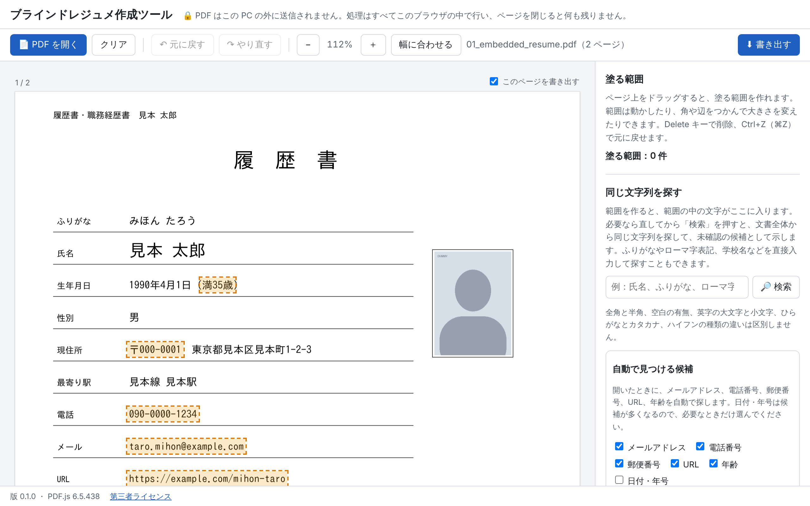

# ブラインドレジュメ作成ツール

履歴書や職務経歴書の PDF から、氏名・写真・連絡先などを黒塗りした PDF（ブラインドレジュメ）を作るツールです。ブラウザだけで動き、PDF はこの PC の外に送信されません。



## 使い方（利用者向け）

### 開き方

次のどちらかで開きます。

- 公開した URL（Vercel）をブラウザで開く
- `dist/index.html` をダウンロードし、ダブルクリックで開く（インターネットにつながっていなくても動きます）

最新の Chrome で使ってください（Edge でも動きます）。Chrome のシークレット ウィンドウで開くと、拡張機能が動かず、履歴も残らないので、より安全です。

### 手順

1. **開く**：「PDF を開く」で、履歴書や職務経歴書の PDF を選びます。画面にドラッグ＆ドロップしても開けます。パスワード付きの PDF は、パスワードを入力します（保存はしません）。
2. **自動の候補を確かめる**：開くと、メールアドレス、電話番号、郵便番号、URL、年齢を自動で探し、オレンジの点線の枠で「未確認の候補」として示します。右の欄の一覧で、1 件ずつ、またはまとめて「塗る」「塗らない」を選びます。日付・年号も探したいときは、チェックを入れて「この設定で探す」を押します。
3. **範囲を囲む**：ほかに伏せたい箇所（氏名、ふりがな、写真、署名など）を、ページの上でドラッグして囲みます。囲んだ範囲は半透明で表示されるので、下の文字を見ながら位置を合わせられます。
4. **同じ文字列を探す**：囲んだ範囲の文字が、右の欄の検索語に入ります。「検索」を押すと、文書全体から同じ文字列を探して候補にします。ふりがな、ローマ字表記、学校名などを直接入力して探すこともできます。
5. **書き出す**：「書き出す」を押し、解像度（既定は 200dpi）を選びます。ページを画像にして黒く塗った PDF を作り、自動で検査します。
6. **目で確かめてダウンロードする**：確認画面で、検査の結果と、元の PDF との比較を見ます。チェックリストの箇所が伏せられていることを確かめ、確認のチェックを入れると、ダウンロードできます。ファイル名は `blind_resume_日付_時刻.pdf` で、変更できます。

### そのほかの操作

| 操作 | 方法 |
|---|---|
| 範囲を動かす・大きさを変える | 範囲の中をドラッグ、角や辺のつまみをドラッグ。矢印キーで 1pt（Shift で 10pt）ずつ動く |
| 範囲を消す | 範囲を選んで Delete キー、または範囲の上の「削除」 |
| 全ページの同じ位置に適用 | 範囲を選んで「全ページの同じ位置に適用」。大きさや向きが違うページは除き、そのページ番号を表示します |
| 元に戻す・やり直す | Ctrl+Z（⌘Z）、Ctrl+Y・Ctrl+Shift+Z（⌘⇧Z）、または上の「元に戻す」「やり直す」 |
| 拡大・縮小 | 上の「−」「＋」「幅に合わせる」。範囲の位置は変わりません |
| ページを出力から外す | ページの上の「このページを書き出す」のチェックを外す |
| すべて閉じる | 「クリア」。開いていた PDF と、作った範囲を消します |

### 気をつけること

- 書き出した PDF は画像だけでできているので、文字の選択や検索はできません。ファイルは元の PDF より大きくなることがあります。
- 自動の検査が確かめるのは、書き出しの仕組みが正しく働いたかどうかです。伏せるべき箇所をすべて伏せたかどうかは確かめません。最後は必ず目で確かめてください。
- 次のものは、検索でも自動の候補でも見つかりません。目で探して、ドラッグで囲んでください。
  - スキャンした PDF の文字（文字の情報がないため）
  - 写真や画像の中の文字
  - 氏名、ふりがな、学校名、会社名（自動の候補の対象外。検索欄で探してください）
- 候補の枠の位置は、文字の情報からの見積もりです。とくに英数字の多い行では、枠が文字から少しずれることがあります。「塗る」を押す前に、枠が文字を覆っているかを確かめてください。

## 安全設計の要点

詳しくは [docs/security.md](docs/security.md) にあります。

- 処理はすべてブラウザの中で行います。CSP で外部への通信を遮断し、ライブラリ・cMap・フォント・WASM はすべて `index.html` に埋め込んでいます。
- 入力の PDF は信頼しないデータとして扱います。最新の PDF.js を使い、CSP（スクリプトはハッシュでのみ許可）と Trusted Types で、スクリプトの実行と HTML の注入を防ぎます。PDF の解析は Worker の中で行います。
- 書き出しでは、ページを画像にして黒く塗り、その画像だけで新しい PDF を作ります。元の PDF の文字、メタデータ、注釈、添付ファイルは引き継ぎません。書き出した PDF は自動で読み直して検査し、すべて合格したときだけダウンロードできます。
- ブラウザの保存領域は使いません。ページを閉じると何も残りません。

## 既知の限界

- **ブラウザ**：対象は最新の Chrome と Edge です（Windows の Chrome を最優先で確かめています）。PDF.js 6.x が新しい JavaScript の機能を使うため、2026 年 2 月以降の版（Chrome 145 以降）が必要です。古い版で開くと、その旨を表示して PDF を開けないようにします。
- **フォント**：フォントを埋め込んでいない PDF は、PC にあるフォントで表示します。元の PDF を作った PC と字形や文字幅が変わることがあります（書き出しも、画面と同じ見た目になります）。
- **候補の位置**：PDF.js は文字のまとまりごとの位置しか返さないため、まとまりの中の文字の位置は見積もりです。全角の文字と、等幅の半角の文字（MS ゴシックなど）は正確に求まります。プロポーショナルの欧文の中や、全角のかなの幅が 1 字分でないフォント（MS P ゴシックなど）では、ずれることがあります。枠は余裕をとって広げていますが、人が確かめる前提です（[docs/design.md](docs/design.md)）。
- **黒の検査の範囲**：書き出し後の「塗った範囲が黒」の検査は、書き出しと同じ座標の変換で範囲を求めます。変換そのものの誤りは、この検査では見つけられません。確認画面の並列表示で目で確かめてください（開発では、別の実装による検査で確かめています）。
- **拡張機能とブラウザの脆弱性**：ブラウザの拡張機能はページの中身を読めます。これと、ブラウザ本体の脆弱性は、このツールでは防げません。
- **メモリ**：JavaScript にはメモリを確実に消す手段がないため、閉じた PDF のデータが実際にメモリから消える時期は、ブラウザが決めます。
- **配信物**：公開して使う場合、配信されるファイルの安全は、GitHub と Vercel のアカウントの守りに依存します（下の「公開の手順」）。
- **大きなページ**：1 ページが 4,000 万画素か、1 辺 16,384px を超える場合は、解像度を自動で下げ、確認画面に表示します。

## 開発

必要なもの：Node.js 22 以降。E2E テストの一部（出力の独立した検査）と、ダミー PDF の作り直しには、Python 3 と `tests/requirements.txt` のパッケージ、poppler（`pdftoppm`）、日本語フォント（IPA ゴシック）が要ります。

```bash
npm ci
npm run build        # 型検査 → 1 ファイルのビルド → ビルド後の検査（dist/ と vercel.json を更新）
npm test             # 単体テスト（Vitest）
npm run test:e2e     # E2E テスト（Playwright。file:// と、ローカルの静的サーバーの両方）
```

- `dist/index.html` と `vercel.json` はコミットする成果物です。ソースを変えたら `npm run build` をして、一緒にコミットしてください。
- 依存を足すときは `npx npm@11 install --save-exact` を使います（npm 10 の `npm install` は依存の解決に失敗します）。
- テストの内容：
  - 単体テスト：座標の変換（PDF.js の viewport との照合を含む）、正規化と元の位置への対応付け、検索と候補の矩形、自動の候補の正規表現、編集と履歴、書き出しの計画と JPEG のメタデータの除去、同梱データ、ビルドの検査。
  - E2E テスト：10 種類のダミー PDF（埋め込みフォント、埋め込みなし、字間の空いた氏名、回転と大きさの混在、CropBox のずれ、メタデータ・注釈・添付ファイル・JavaScript 入り、画像だけのスキャン、透明な OCR 層付きのスキャン、パスワード付き、A0 の大きなページ）で、読み込み、範囲の編集、候補、書き出し、自動検査を通しで確かめます。すべての操作で、外部への通信と CSP の違反が 0 件であることも確かめます。
  - 出力の独立した検査（`tests/tools/verify_output.py`）：アプリとは別の実装（pikepdf、pypdf、poppler）で、書き出した PDF にダミーの氏名などが残っていないこと、指定の位置が黒いことを確かめます。`REQUIRE_INDEPENDENT_CHECKS=1` を付けると、Python の環境がない場合に失敗させます。
- 設計の判断は [docs/design.md](docs/design.md)、決定事項は [docs/decisions.md](docs/decisions.md)、最終の報告は [docs/report.md](docs/report.md) にあります。
- GitHub Actions で、Linux（ビルド、単体、E2E と独立した検査）と、Windows（Chrome、Edge）・macOS（Chrome）の E2E を回します（`.github/workflows/blind-resume.yml`）。

## 公開の手順（Vercel）

1. Vercel にログインし、「Add New → Project」で GitHub の `tabear25/pdf-controller` を選ぶ。
2. 「Root Directory」に `blind-resume` を指定する。
3. 「Framework Preset」は「Other」のままにする。ビルドはしない設定が `vercel.json` に入っている（コミットした `dist/` をそのまま配る）。
4. 「Deploy」を押す。
5. GitHub と Vercel の両方で、2 段階認証を有効にする。配信物を書き換えられるのは、この 2 つのアカウントだけです。main ブランチには、ブランチ保護をかけてください。
6. 配信されている `index.html` の SHA-256 が、`dist/index.html.sha256` と一致するかを確かめる。PowerShell なら `Get-FileHash .\index.html` で求められます。

Vercel は push のたびにプレビューの URL を作るので、変更を本番に出す前に仕事用の PC で確かめられます。設定によっては、プレビューを開くときに Vercel へのログインを求められます。社内のネットワークで vercel.app が開けない場合は、`dist/index.html` をダウンロードして使ってください。

## ライセンス

同梱している第三者のソフトウェアとデータのライセンスは、`dist/THIRD_PARTY_LICENSES.txt` と、アプリの画面下の「第三者ライセンス」で確認できます。
